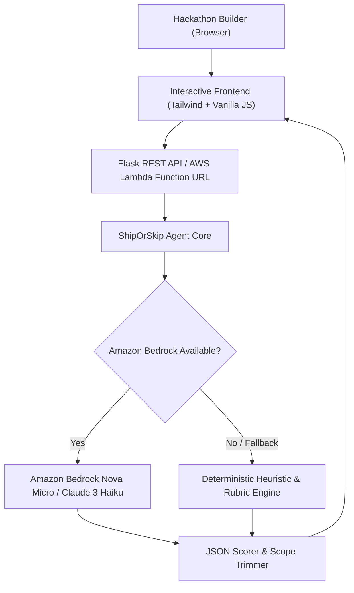

# 🚀 ShipOrSkip AI: The Hackathon Sanity & MVP Scope Coach

> **Built for the AWS Builder Center Weekend Agent Challenge (#agents)**  
> *Small and delightful beats big and clunky.*

[](https://python.org)
[](https://aws.amazon.com/bedrock/)
[](https://aws.amazon.com/lambda/)
[](LICENSE)

---

## 🎯 What and Who

### The Problem
During 24-to-48 hour hackathons, brilliant ideas die at 3 AM. Why? **Scope creep.** Teams get stuck wrestling with authentication, third-party payment gateways, complex multi-agent frameworks, or Kubernetes clusters when all judges care about is **one working end-to-end loop**.

### Who It Is For
**ShipOrSkip AI** is an AI agent built for tired hackathon teams, solo developers, and weekend sprint builders.

### What It Does
1. **Feasibility Verdict (0–100%)**: Calculates whether your scope can be shipped before the countdown expires.
2. **The Fatal Rabbit Hole**: Identifies the single most dangerous feature or rabbit hole that will consume 6 hours without adding judge value.
3. **The "Golden Path" One-Feature MVP**: Synthesizes the core essence of your idea into one clean input-to-output loop.
4. **Countdown Sprint Plan**: Breaks the remaining hours into 3 strict phases (Core Logic, Happy Path UI, Pitch & Video Demo).
5. **Instant Scope Slasher**: Gives an explicit list of secondary features to drop or mock with hardcoded JSON.

---

## 🏗️ Architecture



### AWS Services & Tools Used
* **Amazon Bedrock**: Foundation model reasoning powered by `amazon.nova-micro-v1:0` (fast, cost-effective, precise JSON structure).
* **AWS Lambda & Function URL**: Zero-maintenance serverless execution environment with zero API keys exposed.
* **IAM**: Least-privilege role scoped solely to `bedrock:InvokeModel`.
* **Python 3.12 & boto3**: Lightweight, zero-bloat runtime.

---

## ✨ The Delightful Detail

**A personality that adapts to the pressure, and never fails silently.**

1. **The Coach Persona Slider**:
   * 🌱 **Senior Mentor**: Warm, empathetic guidance that calms 3 AM panic.
   * 📐 **Pragmatic Tech Lead**: Crisp, architectural focus on timeboxing and decoupling.
   * 🔥 **Brutal 3 AM Judge**: Sharp, witty reality check that calls out over-engineered fluff with humorous tough love.
2. **The "Never Leave You Stuck" Principle**: If model quotas or credentials fail, the agent seamlessly switches to a deterministic heuristic engine without throwing stack traces or blank screens.
3. **One-Click Team Export**: A single button copies a formatted, markdown-ready action plan directly into your team's Slack or Discord channel.

---

## 🚀 Quickstart (Run Locally in 1 Minute)

### 1. Clone & Install
```bash
git clone https://github.com/your-username/ship-or-skip-agent.git
cd ship-or-skip-agent
pip install -r requirements.txt
```

### 2. Configure AWS (Optional for Bedrock)
```bash
export AWS_ACCESS_KEY_ID="your-key"
export AWS_SECRET_ACCESS_KEY="your-secret"
export AWS_DEFAULT_REGION="us-east-1"
```
*(If no AWS credentials are set, the agent automatically runs in offline heuristic mode with zero downtime!)*

### 3. Run Web App
```bash
python app.py
```
Open **`http://localhost:5000`** in your browser.

---

## 🧪 Automated Testing

Run the included test suite:
```bash
python test_agent.py
```

---

## 📜 License
MIT License.
